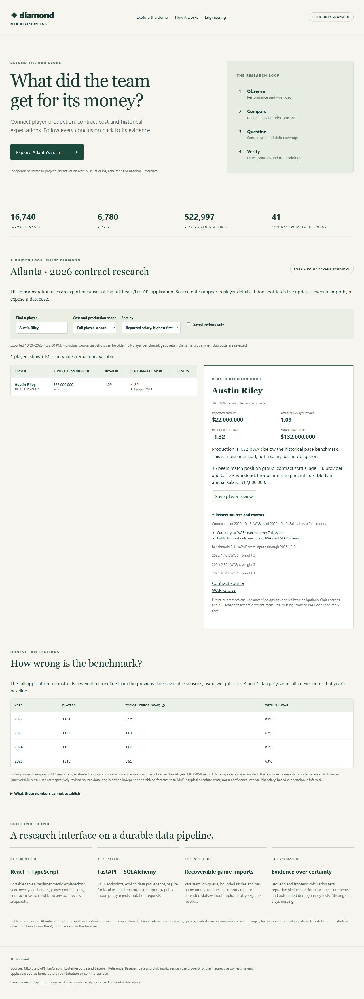

# Diamond — MLB Decision Lab

A full-stack baseball research platform connecting player production, contract costs, historical expectations and the evidence behind each comparison.

**[Explore the portfolio demo](https://diamond-mlb-decision-lab.mellowtang37.chatgpt.site)** · [Architecture](docs/ARCHITECTURE.md) · [Methods and limitations](docs/METHODOLOGY.md) · [Measured results](reports/performance.json) · [Deployment](docs/DEPLOYMENT.md)

The public demonstration is a frozen Atlanta contract-research snapshot. The full local application includes all teams, players, game logs, leaderboards, year-over-year changes, comparisons, favorites and ingestion controls. The snapshot demo does not run the Python backend or fetch live data.



## Why this project

A statistics table can show who performed. Diamond helps investigate what changed, how production relates to reported costs, whether a comparison is fair, and which source gaps prevent a confident conclusion. Salary efficiency, historical performance expectations and published projections remain separate measures.

- **Explainable contract research:** player briefs, club-only versus full-player scope, remaining guarantees, named descriptive peers and annual contract snapshots.
- **Historical expectations with measured error:** prior-three-season 5:3:1 bWAR baseline, tested retrospectively on completed seasons. No target-year leakage; limitations and survivorship bias are disclosed.
- **Deep exploration:** sortable rankings, beginner metric explanations, advanced rates, workload thresholds, year changes, rolling form, Statcast context and player comparisons.
- **Recoverable ingestion:** persistent queue, retries, per-game transactions, idempotent correction imports and source timestamps.
- **Review workflow:** browser-local favorites and saved review snapshots, explicit stale/missing data, JSON research exports.

## Stack

React 19 · TypeScript · Vite · FastAPI · SQLAlchemy · SQLite locally · PostgreSQL support · pytest · Playwright · GitHub Actions

## Run the complete app

Requires Python 3.11+ and Node 22.12+ with pnpm 11.25.0.

```sh
cd backend
python -m venv .venv
# Activate .venv with the command for your operating system.
python -m pip install -r requirements.txt
python -m uvicorn app.main:app --host 127.0.0.1 --port 8000
```

In another terminal:

```sh
cd frontend
corepack enable
corepack prepare pnpm@11.25.0 --activate
pnpm install --frozen-lockfile
pnpm dev
```

Open `http://127.0.0.1:5173`. REST documentation: `http://127.0.0.1:8000/docs`. A fresh database starts empty; choose Imports and load a small historical date range. Windows users with installed dependencies can use `./Start.ps1`. Never commit your runtime database or raw source downloads.

## Try the included snapshot without a backend

```sh
python -m http.server 4174 --directory portfolio-demo
```

Open `http://localhost:4174`. Search the roster, compare club/full-player scope, select a player, inspect source caveats and save a browser-local review. Public baseball data is included as a frozen export, with individual source dates. This is not a complete database seed or an authoritative current roster.

## Verification

```sh
cd backend
python -m pytest -q
cd ../frontend
pnpm test
pnpm build
pnpm exec playwright install chromium
pnpm test:e2e
```

GitHub Actions runs backend tests, frontend calculation checks, the production build and desktop/mobile snapshot-demo journeys. The workflow must run on a connected GitHub repository before claiming CI has passed. Local verification and measurements are recorded in [verification](docs/VERIFICATION.md).

## Measured scale

On the local database measured October 26, 2026: **16,740 games**, **6,780 player directory entries**, and **522,997 batting/pitching player-game records**. This includes all imported competitions and years, not only MLB regular-season games. Five sequential cached/local HTTP requests measured a median of **245.51 ms** for the Atlanta contract endpoint. This is a local loopback measurement, not a production throughput claim; see the raw [measurement report](reports/performance.json).

## Sources and responsible interpretation

MLB Stats API provides official baseball context; public FanGraphs RosterResource pages provide source-reported contract/payroll figures; Baseball Reference provides bWAR. Public Steamer references use fWAR and are never subtracted from bWAR actuals. No paid archive bypass is used. Sources may have different dates and may be revised. Review source terms before redistributing or commercializing data. Club marks belong to their owners; this project is unaffiliated with the sources or leagues.

Code license: [MIT](LICENSE). That license does not grant rights to third-party data, club marks or source content. See [methodology](docs/METHODOLOGY.md) for scope and [research notes](docs/RESEARCH_NOTES.md) for detailed feature documentation.
