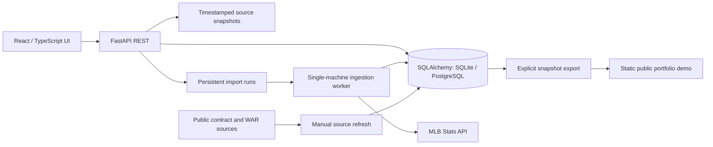

# Architecture

The frontend uses same-origin `/api` calls. Vite proxies API requests locally; production FastAPI can serve the built frontend from `MLB_FRONTEND_DIR`. Separate UI and API hosting would need explicit origin/proxy configuration.

The core models represent teams, players, games, batting/pitching appearances, ingestion runs and raw source payloads. Exact MLB IDs join sources. Player-game appearances preserve team identity; innings use integer outs. Contract records use player/team/year keys and source-tracked JSON fields. Contract imports retain an audit record.

Each game and its player lines commit atomically. Reimporting replaces corrected/deleted lines rather than adding duplicates. Timeout/429/server errors retry with bounded backoff. One OS lock protects the local worker; this is not a distributed queue. Interrupted runs retain saved games and need an explicit retry.

Explorer snapshots retain source/fetch dates and can serve labeled stale values during upstream failures. Missing values do not become zero. Source downloads and databases are excluded from Git.

The public static demo has no backend, credentials, mutation endpoints or live ingestion. A separate Docker configuration supports a read-only Python API deployment: mutation requests are rejected and automatic workers are disabled. Logical read-only API access still permits internal cache writes; it is not a filesystem-read-only database. Keep its single-instance SQLite volume private.

Tradeoffs: JSON statistic payloads accept source evolution but require runtime validation; browser-local reviews are simple but do not sync; SQLite makes local exploration easy but limits concurrent write scaling. Add schema migrations, authenticated administration and a distributed worker before moving beyond the bounded single-instance deployment described here.
